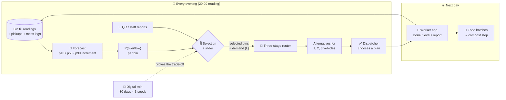
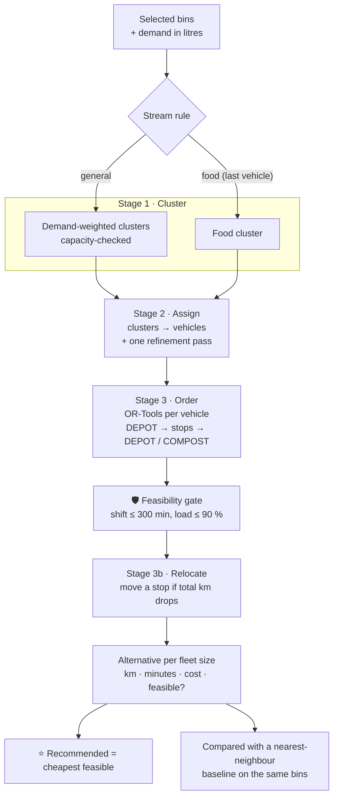
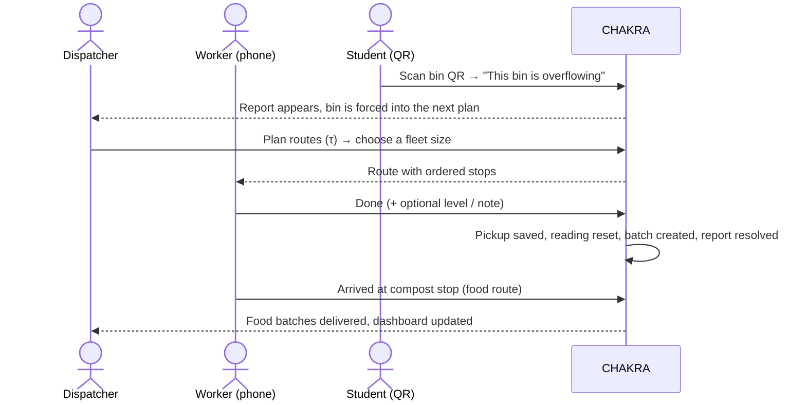
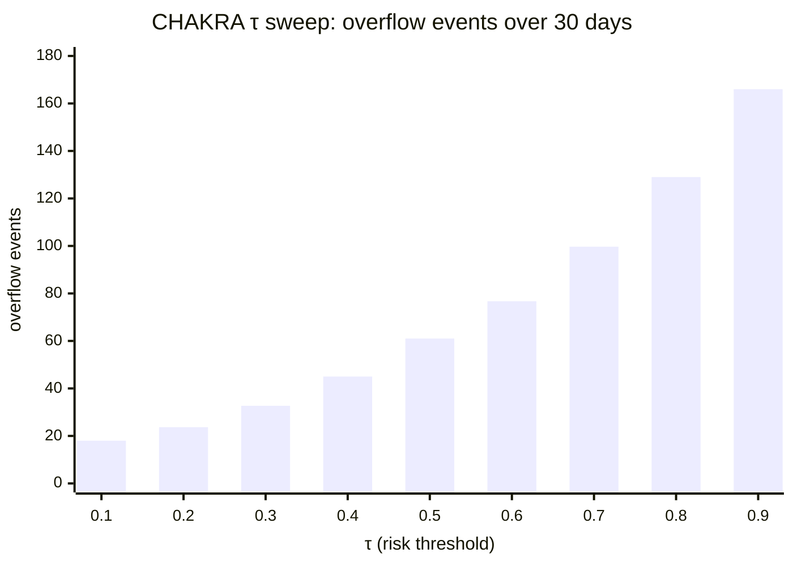
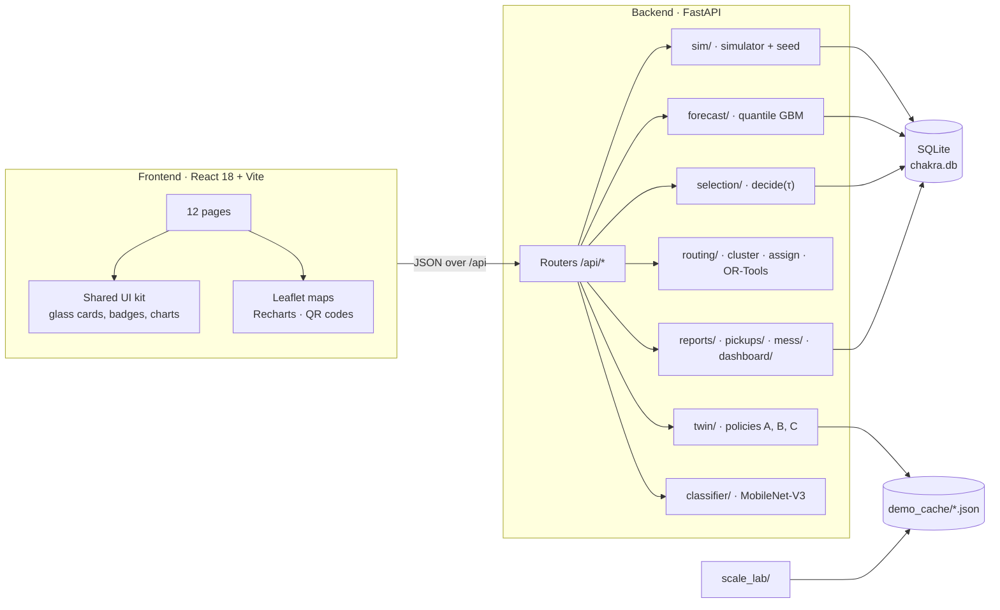

<div align="center">

# 🍃 CHAKRA

### Waste collection that sees *tomorrow*

**Predictive, capacity-safe waste collection for the IIT Roorkee campus**

CHAKRA forecasts which bins will overflow by the end of tomorrow, plans routes for only those bins,
and proves the trade-off on a 30-day digital twin.


[Quick start](#-quick-start) · [How it works](#-how-it-works) · [Results](#-results-simulated) · [Pages](#-a-tour-of-the-app) · [API](#-api-reference) · [Team](#-team)

</div>

---

> [!IMPORTANT]
> **Everything you see is a prototype on simulated data.** Bin fill levels, pickups and mess
> logs are generated by a deterministic simulator. The bhawans, messes and departments are real
> IIT Roorkee places at their OpenStreetMap positions; the individual bins, their fills and
> their history are not. All savings below are **simulated savings**, not field measurements.

## 📑 Contents

- [The problem](#-the-problem)
- [What CHAKRA does](#-what-chakra-does)
- [How it works](#-how-it-works)
  - [1. Simulated campus](#1-simulated-campus)
  - [2. Forecast: how full will each bin be tomorrow?](#2-forecast-how-full-will-each-bin-be-tomorrow)
  - [3. Selection: which bins need a visit? (the τ slider)](#3-selection-which-bins-need-a-visit-the-τ-slider)
  - [4. Routing: three stages + a safety gate](#4-routing-three-stages--a-safety-gate)
  - [5. Worker, reports, mess log and compost handoff](#5-worker-reports-mess-log-and-compost-handoff)
  - [6. Digital twin: does it actually help?](#6-digital-twin-does-it-actually-help)
  - [7. Item classifier](#7-item-classifier)
- [Results (simulated)](#-results-simulated)
- [A tour of the app](#-a-tour-of-the-app)
- [Quick start](#-quick-start)
- [Demo script](#-demo-script)
- [Architecture](#-architecture)
- [Repository layout](#-repository-layout)
- [API reference](#-api-reference)
- [Configuration and assumptions](#-configuration-and-assumptions)
- [Testing](#-testing)
- [Deployment](#-deployment)
- [Pilot cost](#-pilot-cost)
- [Honesty rules](#-honesty-rules)
- [Limitations and roadmap](#-limitations-and-roadmap)
- [Team](#-team)
- [Credits](#-credits)

---

## 🧩 The problem

Campus waste trucks usually follow a **fixed route**: every bin, every day. That wastes fuel and
staff time on half-empty bins, while the bins that really fill up (a mess after dinner, a hostel
before exams) still overflow between visits. Nobody knows *tomorrow's* fill, so nobody can plan
for it.

## ✨ What CHAKRA does

| Step | What happens | Where |
|---|---|---|
| 🔮 **Forecast** | Every evening, a quantile model predicts each bin's fill for the end of tomorrow, with an uncertainty band and a **probability of overflow** | Risk map |
| 🎚️ **Select** | A dispatcher moves one slider, **τ (tau)**, to choose how cautious to be. Bins above τ, overflowing bins, reported bins and bins with no fresh reading are visited | Plan tomorrow |
| 🚚 **Route** | A three-stage planner (cluster → assign vehicles → OR-Tools ordering) builds capacity-safe routes for 1, 2 and 3 vehicles, checks shift limits, and compares itself with a nearest-neighbour baseline | Plan tomorrow |
| 📱 **Collect** | Workers see their route on a phone, tap **Done** and optionally the level. Food routes end at the compost stop | Worker |
| 📣 **Report** | Anyone can scan a bin's QR code to report an overflow or a missed pickup; the bin enters the next plan | QR sheet, Reports |
| 🍛 **Log** | Mess staff log food waste per meal; it feeds the food-bin forecast | Mess log |
| 🧪 **Prove** | A 30-day digital twin compares a fixed route, a simple 70%-full rule and CHAKRA across the whole τ range | Twin lab |
| 🔍 **Sort** | One photo of one item → suggested bin (paper, plastic, metal, organic, other, battery) | Check an item |

---

## 🛠 How it works



### 1. Simulated campus

<details open>
<summary><b>50 bins at 13 real IIT Roorkee locations</b></summary>

| Type | Places (real names, OpenStreetMap positions) | Bins | Capacity | Stream |
|---|---|---|---|---|
| 🏠 Hostels | Rajendra, Rajiv, Radhakrishnan, Govind, Kasturba, Sarojini Bhawan | 6 × 5 = 30 | 240 L | general |
| 🍽️ Mess general | Jawahar Bhawan Mess, Cautley & Ganga Bhawan Mess, Ravindra Bhawan Mess | 3 × 2 = 6 | 660 L | general |
| 🥗 Mess food | the same three messes | 3 × 2 = 6 | 120 L | food |
| 🏛️ Departments | Civil Engg, Electrical Engg, Mechanical & Industrial Engg, Computer Science & Engg | 4 × 2 = 8 | 120 L | general |

- Each bin sits within about 50 m of its building. Bin codes stay short (`HA-1`, `M1-F1`, `D2-2`).
- **45 days of history** are generated with a fixed seed: daily fill increments per group type
  (hostel 22 %, mess 30 %, department 15 % of capacity on average), weekday and exam-week effects,
  per-bin multipliers, sensor noise, 2 % missing readings and two bins with **no fresh reading**
  (to show the "needs review" path).
- Mess food waste is simulated per meal (breakfast, lunch, snacks, dinner) and category
  (plate, kitchen prep, unserved) and drives the food bins.
- A synthetic **depot** and **compost stop** start and end the routes.

</details>

### 2. Forecast: how full will each bin be tomorrow?

<details>
<summary><b>Quantile gradient boosting with an honest time split</b></summary>

- **Target:** a bin's fill increment from one evening to the next (after a pickup the increment is
  the new reading).
- **Features:** group type, weekday, weekend flag, exam week, capacity, mean of the last 7
  increments, the last increment, and for food bins the previous day's mess-log kg.
- **Model:** scikit-learn `GradientBoostingRegressor(loss="quantile")` trained three times for the
  10th, 50th and 90th percentile.
- **P(overflow):**
  `σ = max((p90 − p10) / 2.563, 1)`, `z = (100 − (current + p50)) / σ`,
  `P(overflow) = ½·erfc(z / √2)`.
- **Evaluation:** last 10 days held out (never a random split), compared with "tomorrow = the last
  increment".

| Forecast quality (simulated history) | Value |
|---|---|
| Training / validation days | 34 / 10 |
| MAE of the model (fill %) | **6.20** |
| MAE of the last-value baseline | 9.12 |
| Error reduction | **−32 %** |
| Share of validation points inside the p10–p90 band | 82.4 % |

</details>

### 3. Selection: which bins need a visit? (the τ slider)

<details>
<summary><b>Five rules, first match wins</b></summary>

| # | Rule | Visit? |
|---|---|---|
| 1 | **Overflowing now**: latest reading ≥ 100 % | ✅ |
| 2 | **Reported**: an open overflow or missed-pickup report | ✅ |
| 3 | **Needs review**: no fresh reading for 36 h | ✅ (visit and tap a level) |
| 4 | **P(overflow) > τ** | ✅ |
| 5 | otherwise | ⏭️ skip |

τ runs from 0.05 to 0.95. **Low τ = careful** (visit more bins, fewer overflows);
**high τ = saving** (visit fewer bins, more risk). The page shows how many overflows are expected
among the skipped bins, so the dispatcher sees the cost of every slider position.
On the seeded scenario, τ 0.5 selects 16 of 50 bins and τ 0.1 selects 24.

</details>

### 4. Routing: three stages + a safety gate



<details>
<summary><b>Routing details</b></summary>

- **Stream rule:** with both streams and k ≥ 2 vehicles, the last vehicle carries food waste and
  ends at the compost stop; the others carry general waste back to the depot.
- **Cluster count:** each stream tries every cluster count from `ceil(demand / capacity)` up to its
  vehicle count and keeps the cheapest that serves every stop, so a light day can leave a
  vehicle idle.
- **OR-Tools:** `RoutingIndexManager(n, 1, [start], [end])` with a cheapest-arc first solution and
  guided local search (1 s per cluster in the app, first solution only in the twin).
- **Feasibility gate:** if a route breaks the 300-minute shift, its most expensive stop moves to
  another route that has room; otherwise the bin is listed as unassigned and the alternative is
  marked **manual dispatch required**.
- **Distances:** straight-line × detour factor 1.3 at 15 km/h with 3 minutes per bin.
- **Cost:** ₹800 per vehicle used + ₹12 per km (assumptions).
- **Baseline:** nearest neighbour on the same bins and fleet size, so the saving is measured
  against a sensible simple method, not a strawman.

</details>

### 5. Worker, reports, mess log and compost handoff

<details>
<summary><b>The operational loop</b></summary>



- **Reports** from QR codes are marked *unverified*; staff reports are *verified*. Repeated reports
  for the same bin are merged. A dispatcher can reject a report.
- **Mess log:** per mess, meal, category and kg, with a "weighed on scale" flag.
- **Compost handoff:** CHAKRA records that a food batch was **delivered** to the compost stop. It
  never claims how much compost was produced.

</details>

### 6. Digital twin: does it actually help?

<details>
<summary><b>Same campus, same random days, three policies</b></summary>

- 45 warm-up days, then **30 evaluation days**, repeated for **3 random seeds** (11, 22, 33).
- **Common random numbers:** every policy faces exactly the same waste on the same days.
- **The same router** for every policy, so the twin compares *which bins are visited*.
- Policies:
  - **A · Fixed route**: every bin, every day.
  - **B · Simple rule**: visit when the reading is above 70 %.
  - **C · CHAKRA**: the selection rules above, swept over τ = 0.1 … 0.9.
- Overflow event = a bin-day whose true fill is ≥ 100 % at 20:00.

</details>

### 7. Item classifier

<details>
<summary><b>One photo of one item → which bin</b></summary>

- MobileNet-V3-Small fine-tuned on public waste-image datasets (Garbage Classification 12 classes,
  RealWaste, optional TrashNet) into six classes:
  `battery · metal · organic · other · paper · plastic`.
- Confidence below 0.6 → "Unsure, ask staff". Batteries are always flagged **hazardous**.
- Accuracy is only ever read from the model's own report file; the classifier never feeds routing.
- Training runs on a free Kaggle GPU (`ml/RUN_ON_KAGGLE.txt`). The model file is not committed;
  without it the page says the classifier is not loaded and the rest of the app works normally.

</details>

---

## 📊 Results (simulated)

**30 simulated days, mean of 3 seeds, real IIT Roorkee layout.**

| Policy | km | Overflow events | Pickups | Route minutes |
|---|---:|---:|---:|---:|
| A · Fixed route (every bin daily) | 263.0 | 0.0 | 1,500 | 5,552 |
| B · Simple rule (> 70 % full) | 183.3 | 36.3 | 417 | 1,985 |
| C · CHAKRA, τ 0.5 | 180.3 | 61.0 | 393 | 1,900 |
| **C · CHAKRA, τ 0.1** | **191.3** | **18.0** | **444** | **2,096** |

> **CHAKRA at τ 0.1 vs the fixed route:** 27 % fewer km, 62 % less route time, 70 % fewer pickups.
> **vs the simple 70 % rule:** half the overflow events (18.0 vs 36.3) for about 4 % more km.

<details>
<summary><b>📈 The trade-off curve (every τ)</b></summary>



| τ | 0.1 | 0.2 | 0.3 | 0.4 | 0.5 | 0.6 | 0.7 | 0.8 | 0.9 |
|---|---|---|---|---|---|---|---|---|---|
| km | 191.3 | 186.1 | 184.1 | 184.9 | 180.3 | 191.5 | 190.4 | 189.3 | 184.3 |
| Overflow events | 18.0 | 23.7 | 32.7 | 45.0 | 61.0 | 76.7 | 99.7 | 129.0 | 166.0 |
| Pickups | 444 | 428 | 415 | 403 | 393 | 385 | 374 | 364 | 351 |

Lower τ buys fewer overflows with a few more pickups; km stays roughly flat because the selected
bins cluster in the same parts of campus.

</details>

<details>
<summary><b>🚚 Routing vs nearest neighbour</b></summary>

| Instance | Bins | Vehicles | Three-stage | Nearest neighbour | Saving |
|---|---:|---:|---:|---:|---:|
| Tomorrow's plan at τ 0.1 | 24 | 3 | — | — | **0.77 km (8.1 %)** |
| Scale lab · campus (tomorrow at τ 0.5) | 16 | 2 | 7.10 km | 7.44 km | 4.6 % |
| Scale lab · synthetic city | 2,000 | 30 | 689.3 km | 704.6 km | 2.2 % |

The three-stage planner solves the 2,000-bin city in about 9.5 s on a laptop.

</details>

<details>
<summary><b>🧭 Sensitivity to the detour factor (seed 11)</b></summary>

| Detour factor | Fixed route km | CHAKRA τ 0.5 km | Fewer km |
|---|---:|---:|---:|
| 1.2 | 242.0 | 163.3 | 32.5 % |
| 1.3 | 262.2 | 176.9 | 32.5 % |
| 1.5 | 302.6 | 204.1 | 32.5 % |

The relative saving does not depend on the road-distance assumption.

</details>

> [!NOTE]
> The twin's rupee cost is dominated by the assumed ₹800 per vehicle-day, so CHAKRA is **not**
> claimed to save money in rupees (fixed route ₹52,223 vs CHAKRA τ 0.1 ₹52,429 over 30 days).
> The real gains are km, staff time, pickups and overflows.

---

## 🗺 A tour of the app

| Page | Route | What you can do |
|---|---|---|
| 🏠 **Home** | `/` | Landing page with a live dispatcher preview |
| 🗺️ **Risk map** | `/map` | Every bin coloured by risk; tap one for current fill, forecast, P(overflow), the reason it is (not) visited, tap a level, or report it |
| 🎚️ **Plan tomorrow** | `/plan` | Move τ, see selected/skipped counts and expected overflows, plan routes for 1–3 vehicles, compare with the baseline, see the routes on a map, commit a plan |
| 📱 **Worker** | `/worker` | Phone view of the committed routes: Done, level, note, report overflow, "arrived at compost stop" |
| 📣 **Reports** | `/reports` | Queue of overflow and missed-pickup reports, filter by status, reject |
| 🔍 **Check an item** | `/check` | Take a photo of one item and get the suggested bin |
| 🍛 **Mess log** | `/mess` | Log food waste per mess and meal; daily totals chart |
| 🧪 **Twin lab** | `/twin` | Policy comparison, trade-off chart across τ, sensitivity, all assumptions |
| 📊 **Dashboard** | `/dashboard` | Plan vs baseline km, pickups, reports, batches, fill trend, mess leftovers, forecast quality |
| 🏙️ **Scale lab** | `/scale` | The same planner on the campus and a 2,000-bin city |
| 🔳 **QR sheet** | `/qr` | Printable QR codes, one per bin |
| 📲 **Bin report** | `/bin/:binId/report` | The page a QR code opens on a phone: "This bin is overflowing" / "Pickup was missed" |

Design: Instrument Serif headings with one italic accent word, Inter body text, glass cards over a
looping campus video, a swaying leaf logo. It works on phone width (375 px) with a menu button.

---

## 🚀 Quick start

> [!TIP]
> You need **Python 3.12** (OR-Tools and PyTorch have no wheels for newer versions yet) and
> **Node.js 18+**. Commands are for Windows PowerShell; on macOS/Linux use `.venv/bin/python`.

**1 · Backend**

```bash
cd backend
python -m venv .venv
.venv\Scripts\python -m pip install -r requirements.txt
.venv\Scripts\python -m app.seed --with-twin --with-scale
.venv\Scripts\python -m uvicorn app.main:app --port 8000
```

The seed builds the database, saves one forecast run and rebuilds the twin and scale-lab caches
(about 2 minutes). Without `--with-twin --with-scale` it takes seconds and uses the committed
caches. API docs: <http://127.0.0.1:8000/docs>

**2 · Frontend** (second terminal)

```bash
cd frontend
npm install
npm run dev
```

Open **<http://localhost:5173>**. Vite proxies `/api` to the backend.

<details>
<summary><b>Optional: the item classifier</b></summary>

```bash
cd backend
.venv\Scripts\python -m pip install -r requirements-ml.txt
```

Train the model on Kaggle with `ml/CHAKRA_P1_Kaggle.ipynb` (steps in `ml/RUN_ON_KAGGLE.txt`), then
put `item_classifier.pt` and `classifier_report.json` into `backend/data/model/` and restart the
backend.

</details>

<details>
<summary><b>Optional: phones on the same Wi-Fi (QR codes)</b></summary>

```bash
npm run dev -- --host
```

Open the QR sheet using the laptop's Wi-Fi address (find it with `ipconfig`), not `localhost`,
so the printed codes point to an address a phone can reach.

</details>

<details>
<summary><b>Reset the demo data</b></summary>

```bash
curl.exe -X POST http://127.0.0.1:8000/api/demo/reset
```

Rebuilds the database and the forecast in a few seconds; the twin and scale-lab caches stay.

</details>

---

## 🎬 Demo script

| Time | Page | What to show |
|---|---|---|
| 0:00 | Home → Dashboard | The problem, the pipeline, what is simulated |
| 0:35 | Risk map | Two example bins: one over τ, one with no fresh reading |
| 1:15 | Plan tomorrow | Slide τ to 0.1 → **Plan routes** → alternatives, feasibility, baseline, food route to compost → **Choose this plan** |
| 2:05 | Twin lab | A vs B vs C and the trade-off curve |
| 2:55 | Worker → Reports | **Done** on a stop, **Report overflow** on the next, see it in Reports |
| 3:35 | Check an item | A bottle, a food item, a battery |
| 4:10 | Mess log | Log a meal; the food batch goes to the compost stop |
| 4:35 | Slides | Pilot cost, honesty labels, limits |

Full run sheet with start commands and URLs: [`DEMO_RUNSHEET.txt`](DEMO_RUNSHEET.txt).

---

## 🏗 Architecture



<details>
<summary><b>Tech stack</b></summary>

| Layer | Technology |
|---|---|
| API | FastAPI, Uvicorn, Pydantic v2 |
| Data | SQLite (Python standard library), pandas, NumPy |
| Forecast | scikit-learn `GradientBoostingRegressor` (quantile loss) |
| Routing | Google OR-Tools (`pywrapcp`) |
| Classifier | PyTorch, torchvision MobileNet-V3-Small (optional) |
| Frontend | React 18.3, React Router 6, Vite 5 |
| Maps and charts | Leaflet 1.9 + react-leaflet 4.2, Recharts 2, qrcode.react |
| Tests | pytest, FastAPI TestClient |
| Deploy | Render blueprint (`render.yaml`) |

</details>

<details>
<summary><b>Database tables</b></summary>

`meta`, `bins`, `nodes`, `vehicles`, `fill_observations`, `fill_forecasts`, `plans`,
`route_plans`, `pickup_decisions`, `pickup_events`, `batch_events`, `overflow_reports`,
`item_checks`, `mess_waste_logs` (14 tables). The full schema is in `SPEC.txt` §7 and is created by `backend/app/db.py`.

</details>

---

## 📁 Repository layout

<details>
<summary><b>Show the tree</b></summary>

```text
chakra/
├── backend/
│   ├── app/
│   │   ├── main.py              FastAPI app and routers
│   │   ├── config.py            every constant and assumption
│   │   ├── db.py                SQLite schema and helpers
│   │   ├── seed.py              build the demo database (+ twin, scale lab)
│   │   ├── sim/                 campus layout and daily fill simulator
│   │   ├── forecast/            quantile model, evaluation, P(overflow)
│   │   ├── selection/           decide(conn, tau)
│   │   ├── routing/             cluster, assign, OR-Tools order, feasibility, baseline
│   │   ├── twin/                30-day policy comparison
│   │   ├── scale_lab/           campus vs 2,000-bin city
│   │   ├── reports/ pickups/ mess/ dashboard/
│   │   ├── classifier/          MobileNet inference
│   │   └── routers/             HTTP endpoints
│   ├── data/demo_cache/         twin.json, scale_lab.json, demo_bins.json
│   ├── tests/                   pytest suite
│   └── requirements*.txt
├── frontend/
│   ├── src/pages/               one file per page
│   ├── src/components/          BinMap, RouteMap, ReportOverflowButton
│   ├── src/ui/                  shared kit (Layout, Card, Stat, Slider, …)
│   └── public/media/            background video and poster
├── ml/                          dataset prep, training, evaluation, Kaggle notebook
├── design/mockup/               the approved visual mockup (reference only)
├── presentation/COST_SLIDE.txt  pilot cost slide text
├── SPEC.txt                     the full technical contract
├── DEMO_RUNSHEET.txt            demo-day commands and click path
├── DEPLOY_RENDER.md             Render deployment guide
└── render.yaml
```

</details>

---

## 🔌 API reference

All endpoints are under `/api` and return JSON. Interactive docs: `/docs`.

<details>
<summary><b>Show all 28 endpoints</b></summary>

| Method | Path | Purpose |
|---|---|---|
| GET | `/api/health` | Health check |
| GET | `/api/scenario` | Scenario clock, nodes, vehicles, assumptions |
| POST | `/api/demo/reset` | Rebuild the demo database and forecast |
| GET | `/api/bins` | All bins with the latest reading |
| GET | `/api/bins/{bin_id}/history` | A bin's readings and pickups |
| POST | `/api/observations` | Record a level tap (low / medium / full) |
| POST | `/api/forecasts` | Run and store a forecast for tomorrow |
| GET | `/api/forecasts/latest` | The latest stored forecast |
| GET | `/api/forecasts/eval` | Time-split forecast evaluation |
| POST | `/api/decisions` | Selection for a τ (not stored) |
| POST | `/api/routes` | Plan routes for 1–3 vehicles + baseline |
| GET | `/api/routes/{plan_id}` | A stored plan |
| POST | `/api/routes/{plan_id}/choose` | Commit a fleet size (409 if infeasible) |
| GET | `/api/worker/routes` | Routes of the committed plan |
| POST | `/api/pickups` | Confirm a pickup |
| POST | `/api/pickups/arrive-compost` | Deliver a food route's batches |
| GET | `/api/batches` | Pickup batches and totals |
| POST | `/api/reports` | Overflow / missed-pickup report (multipart, optional photo) |
| GET | `/api/reports` | Report queue by status |
| POST | `/api/reports/{report_id}/reject` | Reject a report |
| POST | `/api/mess-logs` | Log mess food waste |
| GET | `/api/mess-logs` | Logs, daily totals, per-meal averages |
| GET | `/api/dashboard` | Everything the dashboard shows |
| GET | `/api/twin` | Cached twin results |
| POST | `/api/twin/run` | Re-run the twin (about 1–2 minutes) |
| GET | `/api/scale-lab` | Cached scale-lab results |
| POST | `/api/scale-lab/run` | Re-run the scale lab |
| GET | `/api/classify/status` | Is the classifier loaded? |
| POST | `/api/classify` | Classify one item photo |

</details>

<details>
<summary><b>Try it</b></summary>

```bash
curl.exe -X POST http://127.0.0.1:8000/api/decisions -H "Content-Type: application/json" -d "{\"tau\": 0.1}"
curl.exe -X POST http://127.0.0.1:8000/api/routes -H "Content-Type: application/json" -d "{\"tau\": 0.1}"
```

</details>

---

## ⚙️ Configuration and assumptions

All values are **prototype assumptions** in `backend/app/config.py`.

<details>
<summary><b>Show the assumptions</b></summary>

| Setting | Value |
|---|---|
| Vehicles | 3 × 4,000 L, ₹800 fixed per day + ₹12 per km |
| Load limit | 90 % of capacity |
| Shift | 300 minutes |
| Speed / service time | 15 km/h, 3 min per bin |
| Road distance | straight line × 1.3 |
| Level taps | low 25 %, medium 60 %, full 90 % |
| No fresh reading | after 36 hours |
| τ | default 0.5, range 0.05–0.95 |
| Minimum demand of a selected bin | 10 % of capacity (50 % if it has no reading) |
| Food density | 0.6 kg per litre |
| Classifier "unsure" | confidence below 0.6 |
| Time zone | UTC+05:30 (IST) |

</details>

---

## 🧪 Testing

```bash
cd backend
.venv\Scripts\python -m pytest -q
```

**119 tests** cover the simulator, forecast evaluation, selection rules, every routing stage,
feasibility and determinism, the routes API, reports, pickups, mess logs, dashboard, the twin,
the scale lab, the classifier fallback, the deploy config and an end-to-end integration flow.

---

## ☁️ Deployment

CHAKRA deploys to **Render** as two services from [`render.yaml`](render.yaml): `chakra-api`
(FastAPI) and `chakra-web` (static React build). The classifier model is fetched at build time from
a private release. Step-by-step: [`DEPLOY_RENDER.md`](DEPLOY_RENDER.md).

---

## 💰 Pilot cost

A 4-week pilot (one hostel cluster + one mess, 2 staff phones, 1 dispatcher laptop, 1 vehicle):

| Item | One-time | Recurring |
|---|---|---|
| Software | ₹0 (open source) | ₹0 |
| Server | ₹0 (campus machine) | ₹0, or US$4–6 / month |
| Staff phones (2) | ₹0 (own phones), or ₹10,000–14,000 | — |
| Mobile data (2) | — | ₹0 on campus Wi-Fi, or up to ₹378 / 28 days |
| Mess scale | ₹0 if available, or ₹5,900–9,500 | — |
| Classifier | ₹0 (free Kaggle/Colab GPU) | ₹0 (CPU inference) |
| **Total** | **₹0 – about ₹23,500** | **US$4–6 + ₹0–378 / month** |

<sub>Indicative online prices checked 24 Oct 2026, not quotations. Each extra hostel adds at most
2 phones + data; each extra mess at most 1 scale.</sub>

---

## 🧭 Honesty rules

- Every page carries a badge: **IMPLEMENTED** (a working feature) or **SIMULATED** (scenario or
  twin data). Anything not built (cameras, compost output, recycler handoff) is only ever text
  marked **PROPOSED**.
- The app never states measured savings, campus accuracy, or recycled or composted kilograms.
- No result is typed into the UI by hand: every number is computed at run time or read from a cache.
- Classifier accuracy is shown only from the model's own report, labelled with its test set.

---

## 🛣 Limitations and roadmap

- [x] Forecast, τ selection, three-stage routing, worker app, reports, mess log, twin, scale lab
- [x] Real IIT Roorkee places at OpenStreetMap positions
- [ ] Real bin positions and fill readings from a pilot (the app already reads `backend/data/real_bins.csv`)
- [ ] Road-network distances instead of straight line × 1.3
- [ ] Staff log-in and roles (no accounts in the prototype)
- [ ] Fill-level sensors or cameras (proposed only)
- [ ] Campus-photo test set for the classifier

---

## 👥 Team

Built in one day at **SOCIOTHON 2026, IIT Roorkee** by team CHAKRA, by prompting AI coding
assistants against a shared specification (`SPEC.txt`).

| Role | GitHub | Owned |
|---|---|---|
| **P1** · Data, forecast, twin, classifier | [@Sarnav07](https://github.com/Sarnav07) | `sim/`, `forecast/`, `selection/`, `twin/`, `classifier/`, `ml/` |
| **P2** · Core, routing, reports, scale lab | [@lazyKid64](https://github.com/lazyKid64) | `config.py`, `db.py`, `routing/`, `routers/routes.py`, `reports/`, `scale_lab/`, report pages |
| **P3** · Interface, pickups, mess log | [@officiallykaps](https://github.com/officiallykaps) | frontend skeleton and pages, `pickups/`, `mess/`, `dashboard/` |
| **P4** · UI/UX polish | shared | design system, Home page, visual QA |

---

## 🙏 Credits

- Map data © [OpenStreetMap](https://www.openstreetmap.org/copyright) contributors (ODbL).
- Waste-image datasets: Garbage Classification (12 classes, Kaggle), RealWaste (UCI, CC BY-NC-SA 4.0),
  TrashNet (Gary Thung).
- Leaf icon: Lucide (ISC) via AnimateIcons (MIT). Fonts: Instrument Serif and Inter (Google Fonts).
- Routing: Google OR-Tools. Forecasting: scikit-learn.

<div align="center">

**🍃 CHAKRA · collect what will overflow, skip what will not**

</div>
